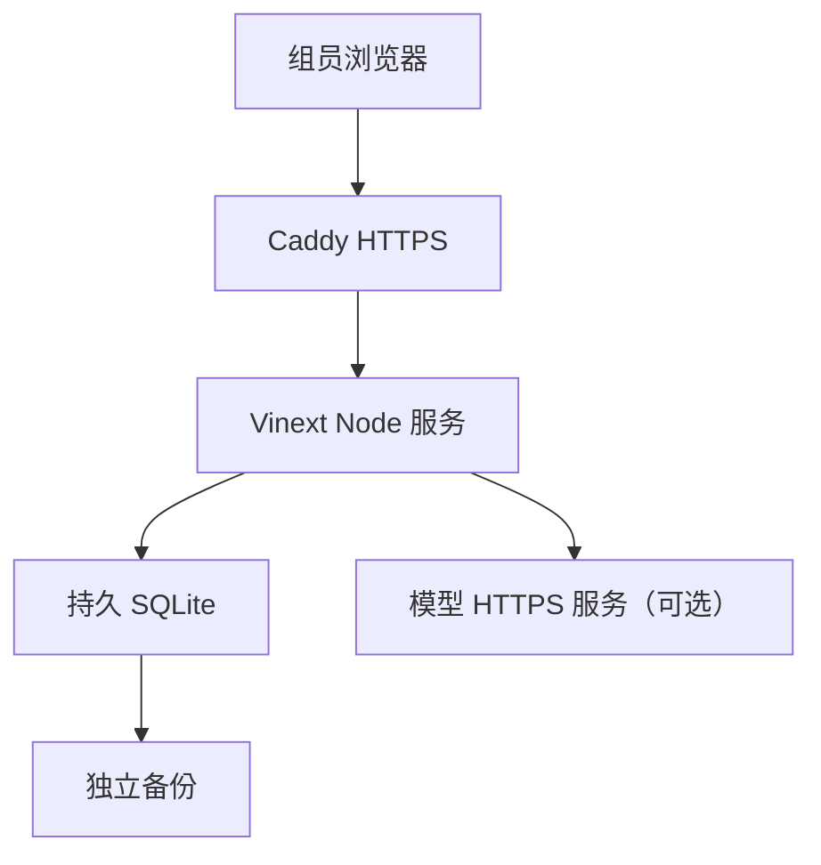

# 国内部署路线与服务器操作交接

本文件是给 WorkBuddy 下一阶段实施的部署说明。当前源码仍是 Sites 版，不能直接把现有 `dist/` 上传到普通服务器当作生产版本。先完成 [DEVELOPMENT.md](DEVELOPMENT.md) 的 Node、SQLite 和认证适配。

## 1. 目标选择

| 路线 | 适用条件 | 本项目处理 |
| --- | --- | --- |
| 腾讯云大陆轻量应用服务器 | 主要供大陆组员长期使用，有域名或计划办理备案 | 推荐默认；Ubuntu 24.04 LTS / Docker CE 模板 |
| 已有阿里云 ECS 或学校 Linux 服务器 | 已有管理权限、网络和运维安排 | 复用现有资源，同一 Compose 方案 |
| 腾讯云/阿里云香港节点 | 先做演示，暂未准备大陆备案 | 可选；访问质量需要实际测试 |
| WorkBuddy 自带网站应用和云服务 | 希望平台托管，愿意接受其运行环境和额度 | 可选；先核实能否保留当前 API、事务、鉴权和持久数据 |

腾讯云官方提供 Docker CE 模板；阿里云官方提供 Docker/Compose 安装说明。参考链接与核实日期见 [SOURCES.md](SOURCES.md)。

WorkBuddy 官方已支持网站应用发布、数据库和身份认证。但公开帮助页并不足以证明当前 Vinext 服务、D1 SQL 和 SQLite 文件可直接部署到它的托管环境，也不能据品牌推定数据所在地。若选此路线，先核实实际地域、SQL/事务能力、持久存储、构建入口、访问控制、费用额度和数据导出能力，再选择相应适配；不把纯静态“轻量发布”当作完整后端。主方案使用普通云服务器，是为了保持源码与部署控制和当前 SQL 语义。

## 2. 服务器与域名准备

推荐初始工程配置：2 vCPU、4 GiB 内存、40–60 GiB 持久磁盘，Linux x86_64。该配置适用于小组试用的起点，没有做并发容量保证；较重模型训练与推理仍独立运行。

- 已有服务器优先使用，不自动购买或升级套餐。
- 确认系统版本、CPU 架构、磁盘、已有服务和端口占用后安装依赖，不直接清空旧站。
- 确认 Node 24 与目标 Linux 容器环境；SQLite 原生驱动在目标架构内安装/构建。
- Docker Hub、npm 与 GitHub 的可达性在实际网络检查。不要用未知镜像站或关闭 TLS/完整性校验；必要时在可用的构建环境生成镜像，再放入团队国内镜像仓库。
- 发布包、镜像标签使用提交 SHA 或不可变版本，避免只用 `latest`。

### 大陆与香港

自有域名用于中国大陆服务器上的正式网站时，按实际接入商流程完成 ICP 备案；域名实名认证、主体材料和接入信息要准备齐全。已有备案更换接入商时仍按接入要求处理。香港节点官方说明不要求大陆 ICP 备案。不要把“国内云厂商”与“大陆地域”混为一谈，也不要用改端口代替备案。[腾讯云官方说明](https://cloud.tencent.com/document/faq/243/19630)；[阿里云备案流程](https://help.aliyun.com/zh/icp-filing/basic-icp-service/user-guide/icp-filing-application-overview)

没有正式域名时可先在本地或 SSH 隧道中验收，不把临时 HTTP 测试地址当作正式登录站。域名、DNS 与备案办理不妨碍 WorkBuddy 先完成本地迁移和容器交付。

## 3. 推荐部署形态

同域页面与 API；单个应用实例；本机持久数据库；独立模型服务。



Node 提供页面和 `/api/v1`，不新增重复业务网关。Caddy 负责 HTTPS 与反向代理；如服务器已有合格 Nginx，可直接复用。外部模型尚未提供时规则基线可正常使用。

推荐宿主机目录（由实施者创建并检查属主）：

| 目录 | 内容 |
| --- | --- |
| `/srv/cleartrace/releases/<版本>/` | 对应版本的发布说明与部署配置 |
| `/srv/cleartrace/shared/data/` | SQLite 数据文件及同目录 WAL/SHM |
| `/srv/cleartrace/shared/backups/` | 本机恢复用备份 |
| `/srv/cleartrace/shared/secrets/` | 私有配置文件，限制读权限 |
| 独立存储位置 | 至少一份不与服务器故障同时丢失的备份 |

容器路径建议 `/data/cleartrace.sqlite`，通过明确的 bind mount 或命名卷持久化。数据库不能放在镜像或容器临时层中；应用进程使用非 root 用户，并预先处理数据目录权限。

## 4. WorkBuddy 需要实际交付的部署文件

下列文件是**待实现清单**，本交接没有伪造一个未经运行的 Docker 成品：

| 拟新增文件/命令 | 应具备的行为 |
| --- | --- |
| `deploy/cn/Dockerfile` | Linux 多阶段构建，Node standalone，包含运行时依赖、迁移和管理工具 |
| `deploy/cn/compose.yaml` | app + HTTPS 代理，明确卷、env、健康检查、重启和日志轮转 |
| `deploy/cn/Caddyfile` | 域名、反向代理、正确 Host/协议、HTTPS |
| `deploy/cn/.env.example` | 无真实秘密的配置示例，与实现一致 |
| `deploy/cn/entrypoint.sh` 或等价入口 | 启动前校验配置；迁移失败则停止；不反复重置账号或填样例 |
| `scripts/migrate-node.mjs` 或等价工具 | SQLite 迁移台账与校验，重复执行安全 |
| 管理员创建/密码重置工具 | 隐藏交互输入、正确密码散列、事务与审计 |
| 备份和恢复工具 | 一致性快照、恢复校验、恢复前保护原文件 |
| `.dockerignore` | 排除 Git 历史、真实 env、数据库、备份、缓存和上传数据 |
| Node CI job | 生产构建、适配器事务检查、身份/业务回归与容器验证 |
| `docs/CN_DEPLOYMENT_RESULT.md` | 最终实际命令、版本、环境、证据与尚未完成项 |

standalone 默认不会读取随意命名的环境文件；Compose 的 `env_file` 或进程环境负责注入。构建期配置和运行期秘密要分开，密钥不得成为 Docker ARG 或前端变量。

## 5. 环境变量契约

[env.node.example](env.node.example) 是拟新增实现的配置契约，不可直接套用到当前 Sites 版。

| 变量 | 用途 | 迁移要求 |
| --- | --- | --- |
| `NODE_ENV` | 正式运行模式 | production |
| `PORT`、`HOST` | Node 内部监听 | 通常 3000、0.0.0.0；端口仅对代理网络开放 |
| `APP_ORIGIN` | 对外站点 origin | 使用准确 HTTPS origin，作为回跳和来源校验依据 |
| `DATABASE_PATH` | SQLite 文件 | 指向持久挂载，如 /data/cleartrace.sqlite |
| `AUTH_MODE` | 认证实现 | Node 使用 session；不读取 Sites 身份头 |
| `SESSION_SECRET` | 会话签名/校验密钥（若所选实现需要） | 每环境独立随机值，支持轮换；禁止弱默认值 |
| `SESSION_TTL_SECONDS` | 会话有效时间 | 明确默认值并按服务端校验 |
| `SEED_DEMO_DATA` | 是否填入合成样例 | 正式默认 false，演示由明确命令启用 |
| `VINEXT_TRUST_PROXY` | 是否使用可信代理头 | 仅在 Node 入口不被公网直接访问时启用 |
| `VINEXT_TRUSTED_HOSTS` | 允许的对外 Host | 精确域名列表，按锁定源码语法配置 |
| `MODEL_SERVICE_URL`、`MODEL_API_KEY` | 外部推理 | 保留现有协议与 20 秒超时 |
| `INTEGRATION_API_TOKEN` | 可选编辑角色自动导入令牌 | 可为空，优先使用可撤销的签发令牌 |

`OWNER_EMAIL` 在当前 Sites 版用于识别首位管理员；Node 版由显式账号管理取代。`CLEARTRACE_SITE_TOKEN` 是旧 Sites 网关访问凭据，不应继续作为新国内站点的登录条件。自动导入脚本只在调用旧站时才需要该旧网关凭据。

## 6. 实施顺序

### 第一步：本地完成 Node 迁移

先完成开发说明中的 M1–M6。保持原 API；使用隔离的本地 SQLite 数据库，保留基线规则结果。跑生产构建和生产会话流程，不只在固定开发管理员环境测试。

### 第二步：本地容器验收

构建镜像，创建持久卷，执行迁移，交互创建管理员，启动应用与代理。记录真正使用的命令和镜像摘要。

导入样例并执行一次任务、复核、导出，然后重建应用容器，确认数据仍在。备份后恢复到新的数据目录，再验证记录和关系。通过后生成部署运行手册。

下面是**待目标文件与脚本实现并验收后**的命令形态，不是当前源码可直接运行的现成命令：

```bash
docker compose --env-file /srv/cleartrace/shared/secrets/app.env -f deploy/cn/compose.yaml config --quiet
docker compose --env-file /srv/cleartrace/shared/secrets/app.env -f deploy/cn/compose.yaml build
docker compose --env-file /srv/cleartrace/shared/secrets/app.env -f deploy/cn/compose.yaml run --rm app npm run db:migrate:node
docker compose --env-file /srv/cleartrace/shared/secrets/app.env -f deploy/cn/compose.yaml run --rm app npm run admin:create
docker compose --env-file /srv/cleartrace/shared/secrets/app.env -f deploy/cn/compose.yaml up -d
```

如果精简镜像没有 npm 或 package.json，应提供等价的直接 Node CLI，并在最终运行手册替换为真实命令。不要保留“执行时才发现不存在”的占位脚本。`config --quiet` 只校验配置，不输出展开的密钥。

### 第三步：部署到已有授权服务器

检查服务器当前状态，创建版本目录与持久目录，上传不可变镜像或对应源码发布包。先备份既有数据，再迁移和启动。域名按实际地域完成前置手续后解析到服务器。

公网通常仅开放 HTTPS/HTTP 入口；SSH 只给管理来源；Node 和模型内部端口不直接发布到公网。Docker 端口映射可能绕开普通主机防火墙的部分规则，所以还应检查云安全组与实际监听情况。[Docker 官方说明](https://docs.docker.com/engine/install/ubuntu/)

Caddy 自动证书依赖正确 DNS、可达的 80/443 端口、可写且持久的证书数据目录。若已有证书和 Nginx，就用现有方案。[Caddy 官方说明](https://caddyserver.com/docs/automatic-https)

### 第四步：核对 HTTPS 写请求

不能只看首页和 health。代理后实际执行导入、创建任务与复核，确认 `verifyOrigin` 等防护在真实外部 HTTPS origin 下正常工作。

现有鉴权按 `new URL(request.url).origin` 比较来源，反向代理配置错误可能造成所有 POST 被拒绝。应正确恢复外部 origin 或改为明确的可信 `APP_ORIGIN` 校验，而不是删除检查。

### 第五步：正式交付

交付网址、提交 SHA、镜像标识、数据库迁移版本、账号初始化方法、成员管理方法、实际备份恢复命令、重启/更新命令，以及完整验收结果。密码与令牌通过私有方式交付，不放公开 README。

## 7. 现有数据如何迁移

### A. 无需保留旧站数据

创建新的空 SQLite 数据库，应用迁移，初始化国内管理员。若需要演示，再显式导入合成样例或运行 demo seed。不要默认声称当前旧站一定只有合成数据；迁移前由所有者确认是否已有新增记录。

### B. 需要保留旧站数据

先确认可以取得 Sites 托管生产数据库的**完整导出**。当前源码只有本地 D1 占位 ID，不能拿它执行远程导出。拥有这个 GitHub 仓库也不自动获得 Sites 的生产数据库访问权。

有真实 D1 管理权限时可参考官方导出流程；如果 Sites 没有暴露该权限，需由站点所有者通过实际可用的导出能力，或经明确授权实施完整导出工具。没有导出能力时继续完成迁移程序与空库验收，并单独标注“旧数据迁移待取得全量备份”。

现有任务 CSV 只包含任务结果，`bootstrap` 和列表接口也有上限；不能作为九张表的无损备份。不能把本地 `.wrangler/state` 当成线上库。

完整迁移步骤：

1. 明确切换窗口，冻结旧站业务写入，处理或记录仍在 running 的任务，避免两个独立站点同时修改后无法合并。
2. 导出九张业务表的结构、数据及必要迁移信息；保留主键、外键、时间、JSON 特征和模型版本，记录校验值与每表行数。
3. 在临时数据库导入并验证。D1 管理表/专用 PRAGMA 按目标 SQLite 实际兼容性处理，不盲目执行所有平台管理语句。
4. 已导入含表结构的 SQL 时，不再无条件执行重复建表迁移；先核对 schema、索引和校验，再建立迁移基线台账。
5. 新增独立认证表，管理员按受控方式绑定成员。旧 Sites 用户 ID 留作历史身份映射；历史审计字段不改写成另一人。
6. 旧会话不迁移。旧 API Token 的散列没有明文恢复价值；确认集成调用方后撤销/重签并更新脚本，不因切换突然遗漏调用方。
7. 逐表比较行数和主键集合、检查外键、复算抽样规则结果、检查历史任务模型版本和复核记录。
8. 验收通过后启用新站；保留旧站为受控回退入口，不默认删除或公开旧站。

特别保留 `settings.seed_version`：旧版 `ensureSeed()` 仅检查这个标记，遗漏时可能重新插入演示数据。Node 正式版默认不填样例，显式 demo seed 也需保持幂等。迁移后的成员“已激活”状态应由新凭证/激活流程决定，不能仅因旧 `members.user_id` 存在就认为新登录可用。

正式切换后旧站应停止业务写入。新站一旦产生新写入，回退前必须保护并核对这些增量；不能只把域名改回旧库而丢弃新记录。

D1 官方导出能力并不代表当前用户已持有底层 Cloudflare 权限。[官方导入导出说明](https://developers.cloudflare.com/d1/best-practices/import-export-data/)

## 8. 备份、更新、恢复

SQLite 使用 Online Backup API、sqlite3 的一致性备份能力或经验证的 `VACUUM INTO` 生成快照；不要在写入中只复制主数据库文件而忽略 WAL 状态。至少实际恢复一次，并运行 `PRAGMA integrity_check` 与 `PRAGMA foreign_key_check`。[SQLite 官方备份说明](https://sqlite.org/backup.html)

建议每天一次备份，版本更新前再备份一次，并保留一份独立存储副本；具体频率依数据更新量调整。备份包含业务数据，应按私有数据管理，不能提交 GitHub。

更新时使用明确版本：备份、校验、迁移、替换应用容器、业务验收。数据库放在固定 shared 目录或固定卷中，不因 release 目录变化而重建。不要运行会删除数据卷的清理命令作为常规更新步骤。

应用回滚只回滚代码和镜像；已执行的数据库迁移需要单独兼容策略。恢复旧库会丢失快照之后的写入，执行前必须明确时间点并保护当前数据。

## 9. GitHub 与发布协作

- 开发在功能分支进行，PR 检查包括 Node 生产模式、适配器事务、登录权限与业务流程。
- 首版可采用“检查通过 → 生成发布包/镜像 → 由发布者更新服务器”。
- 要实现 main 自动发布时，单独新增经过验收的部署 workflow；服务器凭据放在 CI secrets，限制发布目标，部署前备份并执行健康与业务检查。
- 当前 GitHub CI 只检查和打包，不会自动部署国内服务器，也不会自动更新 Sites。
- GitHub 写权限、SSH 发布权限、国内网站应用角色分别管理。组员没有仓库写权限时走 Fork/PR。

## 10. 可选的 WorkBuddy 托管路线

如果决定直接用 WorkBuddy“网站应用”发布，先让它以当前源码做兼容性核查，不重新生成一个外观相似的静态页面。数据库、认证及服务端接口要按实际托管能力迁移，保留事务与角色语义。不能将需要持久化的 SQLite 放在临时函数文件系统。

核实其实际地域、访问策略、资源额度、备份导出和原有 GitHub 协作是否仍可用。发布后检查匿名只能访问登录界面，业务数据仍需身份。官方文档说明预览与发布可能共用同一云服务，所以该路线的写入测试要使用明确的测试数据并清理。相关官方入口见 [SOURCES.md](SOURCES.md)。

